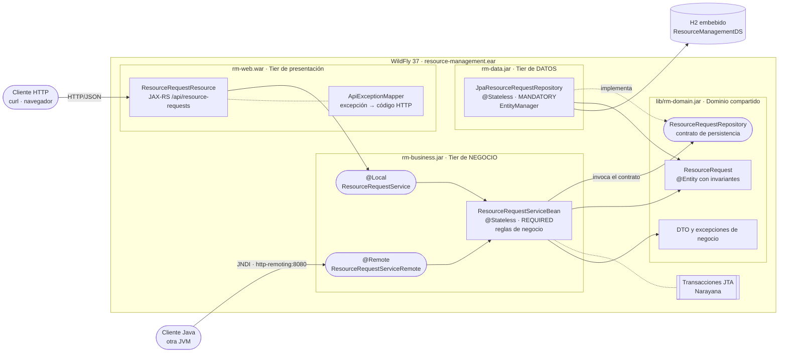

# 01 – Diagrama de componentes

Los tres tiers y el contenido del EAR desplegado en WildFly.

El tier de negocio es el único que conoce las reglas. El tier de presentación deserializa y
traduce errores; el tier de datos solo lee y escribe.
