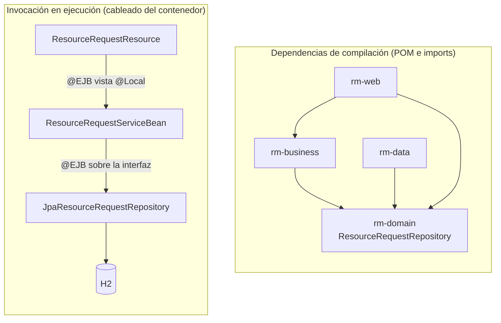

# 02 – Desacople entre el tier de negocio y el de datos

Logramos el desacople haciendo que las dependencias de **compilación** y las de **invocación** apunten en
sentidos opuestos.

`rm-business` no declara a `rm-data` en su POM y no importa sus clases. La
implementación se resuelve al hacer deploy, porque `JpaResourceRequestRepository` publica la vista
`@Local(ResourceRequestRepository.class)`.

## Qué hace cada elemento

| Pieza | Responsabilidad | Lo que nunca hace |
|---|---|---|
| `ResourceRequestResource` | Deserializa el JSON y delega | Validar reglas de negocio |
| `ResourceRequestServiceBean` | Valida, coordina y abre la transacción | Conocer JPA, `EntityManager` o JPQL |
| `ResourceRequest` | Protege sus invariantes y su máquina de estados | Consultar la base de datos |
| `ResourceRequestRepository` | Declara lo que el negocio necesita | Decidir qué es un error |
| `JpaResourceRequestRepository` | `persist`, `find`, JPQL | Validar, lanzar excepciones de negocio |

## Edge transaccional

El negocio declara `@TransactionAttribute(REQUIRED)` y el tier de datos `MANDATORY`. El repositorio
nunca abre una transacción propia, así que cualquier intento de usarlo fuera de una operación de
negocio falla de inmediato. La frontera queda donde corresponde y además queda escrita en el código.

Por eso las consultas del negocio también son `REQUIRED` y no `SUPPORTS`: una lectura que entre por
la vía remota llega sin transacción, y con `SUPPORTS` el repositorio la rechazaría.
