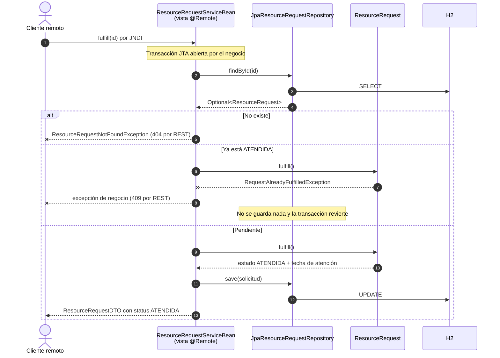

# 04 – Secuencia: atender una solicitud

Leer, validar la transición y escribir ocurren dentro de la misma transacción, de modo que dos
intentos simultáneos de atender la misma solicitud no pueden dejarla en un estado inconsistente.
