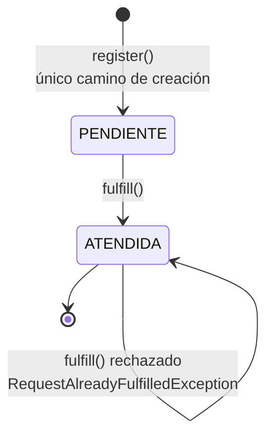

# 05 – Máquina de estados de la solicitud

| Regla | Dónde se hace cumplir |
|---|---|
| Toda solicitud nueva inicia en PENDIENTE | `ResourceRequest.register` fija el estado y no existe constructor público ni setter |
| No se puede atender una solicitud inexistente | `ResourceRequestServiceBean.find` convierte el `Optional` vacío en `ResourceRequestNotFoundException` |
| No se puede atender una ya ATENDIDA | `ResourceRequest.fulfill` verifica `isPending()` |

El estado es un campo de la entidad y solo cambia por `fulfill()`. Ninguna capa puede asignarlo
directamente, ni siquiera enviándolo en el JSON: el cuerpo de la petición no tiene campo de estado.
