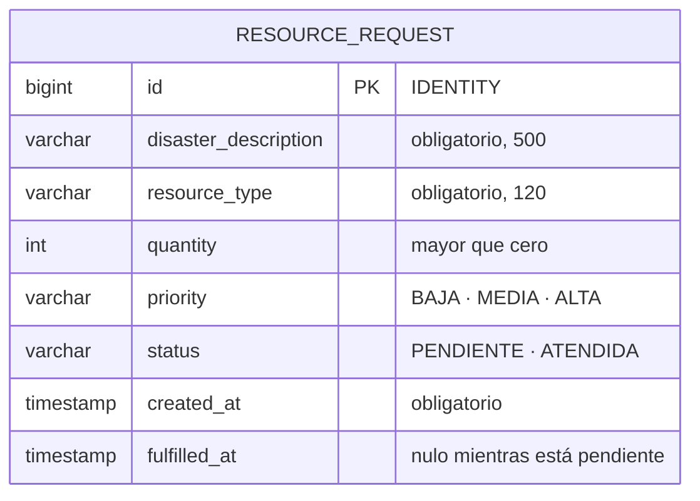

# 06 – Modelo de datos

## Unidad de persistencia

| Aspecto | Valor |
|---|---|
| Nombre | `resourceRequestPU` |
| Tipo de transacción | `JTA` |
| Datasource | `java:jboss/datasources/ResourceManagementDS` |
| Base de datos | H2 en memoria, embebida en WildFly |
| Generación del esquema | `hibernate.hbm2ddl.auto=create` |

El `persistence.xml` viaja en `lib/rm-domain.jar`, junto al mapeo de la entidad, de modo que la
unidad tiene alcance de toda la aplicación. El tier de negocio nunca lo referencia.
