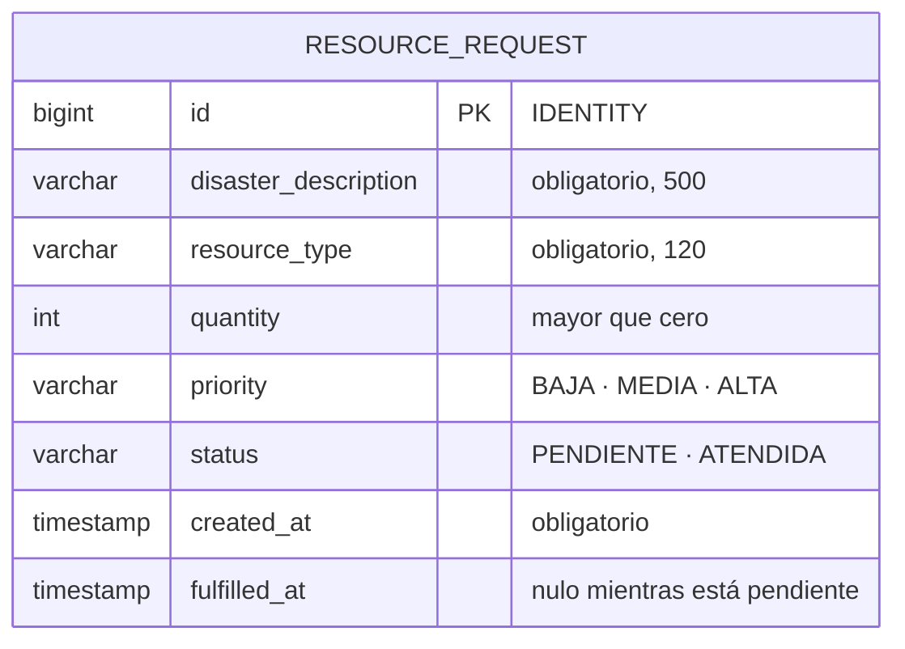

# 06 – Modelo de datos

Una sola tabla: el alcance es una colección de solicitudes, no un modelo relacional extenso.

## Unidad de persistencia

| Aspecto | Valor |
|---|---|
| Nombre | `resourceRequestPU` |
| Tipo de transacción | `JTA` |
| Datasource | `java:jboss/datasources/ResourceManagementDS` |
| Base de datos | H2 en memoria, embebida en WildFly |
| Generación del esquema | `hibernate.hbm2ddl.auto=create` |

El `persistence.xml` viaja en `lib/rm-domain.jar`, junto al mapeo de la entidad, de modo que la
unidad tiene alcance de toda la aplicación. El tier de negocio nunca lo referencia.

H2 en memoria implica que los datos se pierden al reiniciar el contenedor, lo que hace
reproducibles las pruebas. Para conservarlos entre reinicios bastaría cambiar la URL del datasource
a `jdbc:h2:file:...` y `hbm2ddl` a `update`, sin tocar una línea de Java.

Una colección en memoria habría bastado. Se eligió JPA real para mostrar que el tier de negocio
queda igual de ignorante del mecanismo con una base de datos de por medio.
